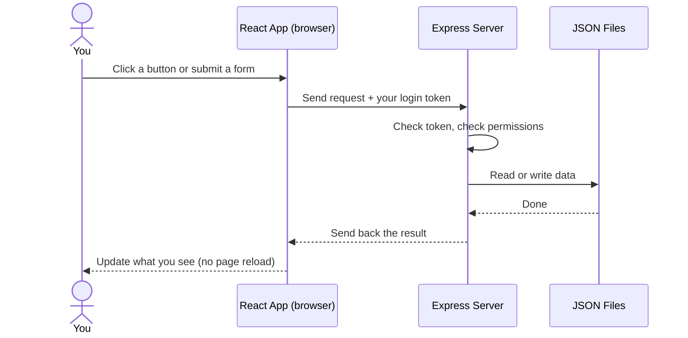
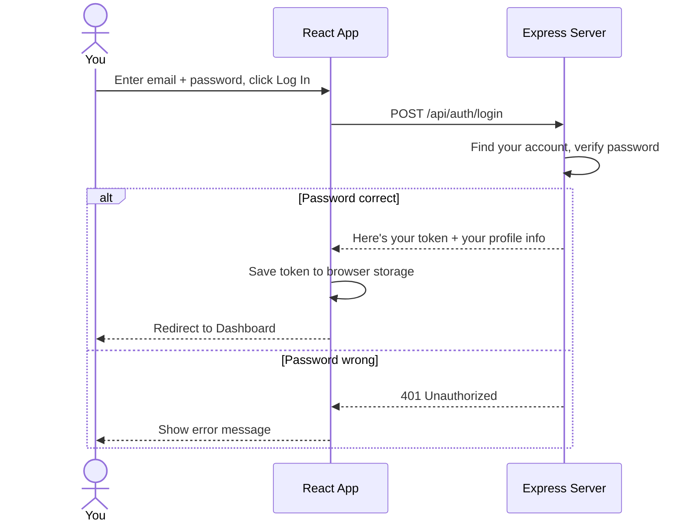
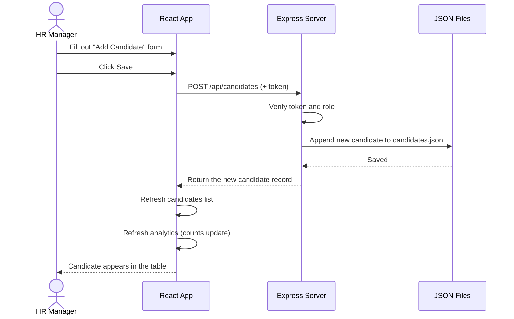
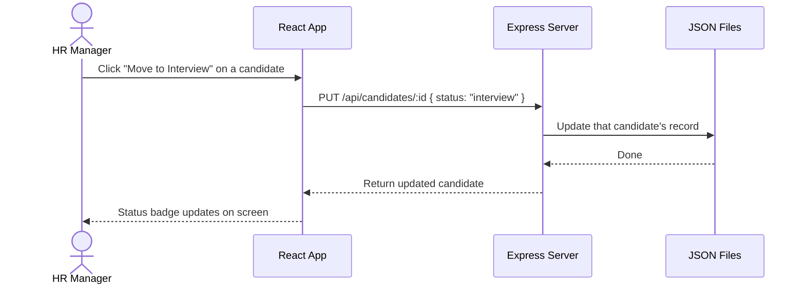
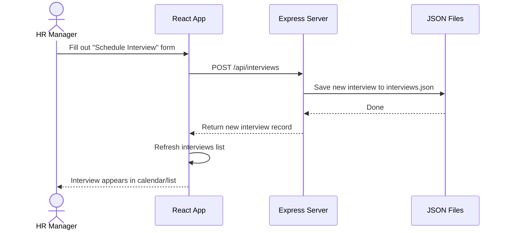
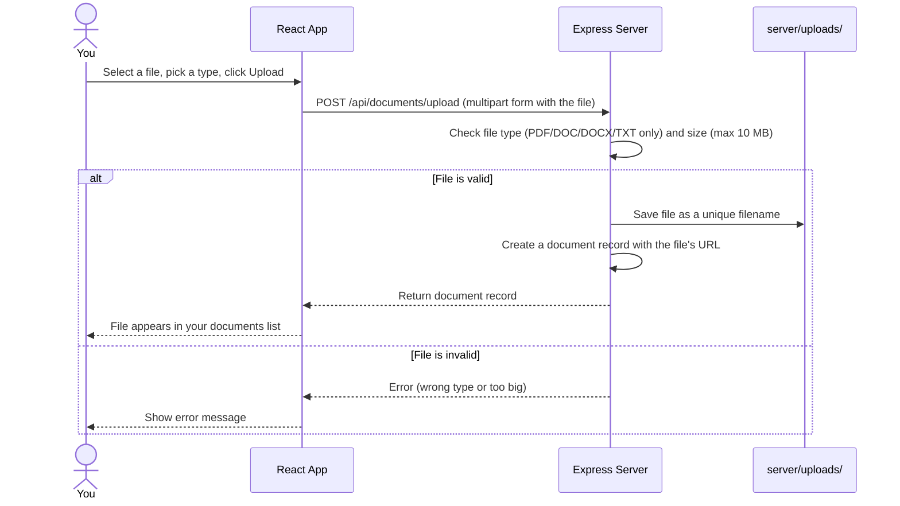
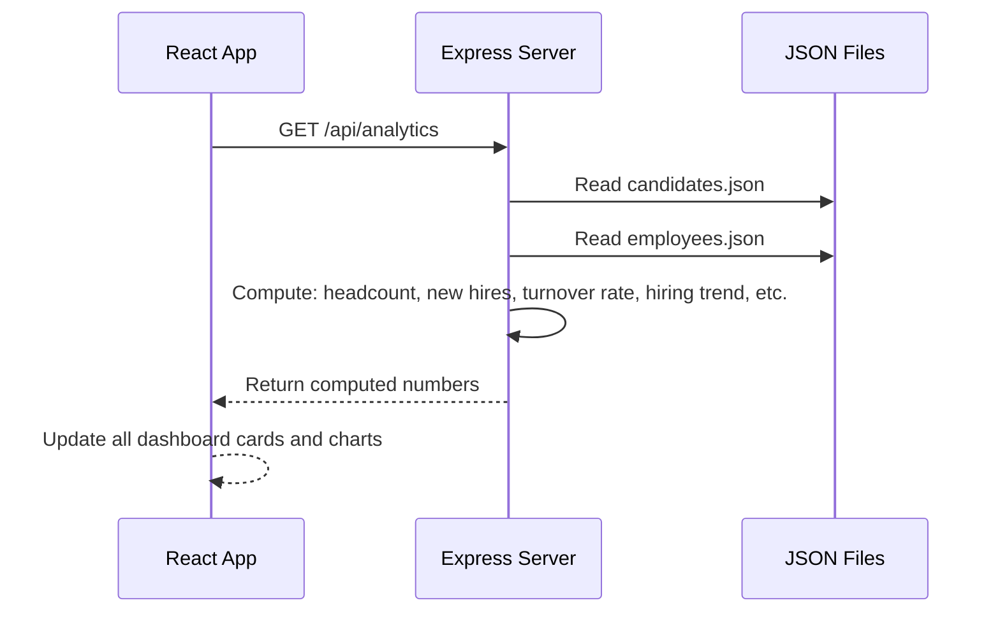

# What Happens When You Click Something

Every action in TalentFlow — clicking a button, submitting a form, loading a page — follows a predictable path. Once you understand the pattern, every feature makes sense.

---

## The Basic Pattern

Here's what happens every time you do anything in the app:

The app never reloads the whole page. When something changes, only the affected part of the screen updates — that's what makes it feel fast.

---

## Logging In

The login flow is slightly different because there's no token yet. This is where you get one.

The token gets attached to every future request automatically. It expires after 7 days, at which point you'll be sent back to the login screen.

---

## Adding a Candidate

Here's the full journey when an HR manager adds a new candidate:

Notice that the app refreshes both the candidates list AND the analytics dashboard automatically. That's because every time data changes, the app knows which screens might be affected and re-fetches only those.

---

## Moving a Candidate Through the Pipeline

Updating a candidate's status (e.g., from Screening to Interview) is a simple update:

---

## Scheduling an Interview

After the interview happens, the interviewer submits feedback via `POST /api/interviews/:id/feedback`. The interview status changes to `completed` and the feedback is stored alongside it.

---

## Uploading a Document

Document uploads work a little differently because they carry a file, not just text.

The file lives on disk at `server/uploads/`. The database just stores a pointer to it (`/uploads/filename.pdf`). When you click to download, your browser fetches the file directly from that path.

---

## How the Analytics Dashboard Stays Fresh

The analytics numbers (total employees, open positions, hiring trend) are computed live every time the dashboard loads — there's no stored snapshot.

This means the dashboard is always accurate. Add an employee → reload the dashboard → headcount is already updated. No sync needed, no background job.

---

## What Gets Refreshed After Each Action

The app tracks which screens are affected by each change and re-fetches only those — not the entire page.

| When you… | The app refreshes… |
|---|---|
| Add / edit / delete a candidate | Candidate list + analytics |
| Schedule / update / cancel an interview | Interview list + analytics |
| Add / edit / remove an employee | Employee list + analytics |
| Complete an onboarding task | Onboarding list |
| Complete an offboarding task | Offboarding list |
| Upload or delete a document | Documents list |
| Update your profile | Your profile display in the header |
