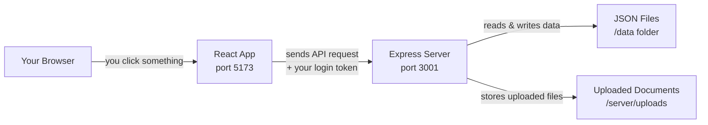
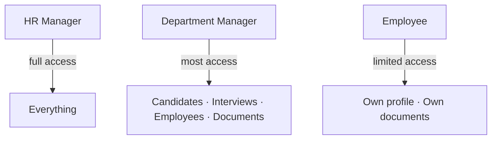
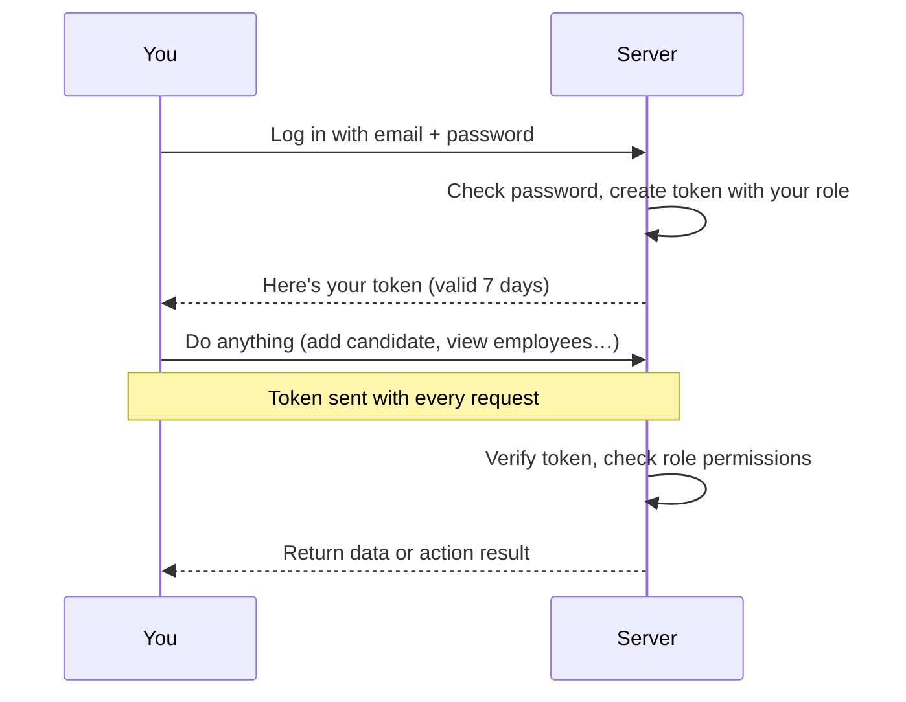

# How TalentFlow Is Built

TalentFlow is an HR platform that takes a new hire candidate all the way through to becoming an active employee — tracking interviews, documents, onboarding tasks, and more in one place. It has three user types (HR Manager, Department Manager, Employee) each seeing only what's relevant to their role.

---

## The Big Picture

When you open TalentFlow in your browser, here's what's actually happening behind the scenes:

**What each piece does:**

- **React App** — the visual interface you interact with. Runs entirely in your browser. When you click "Add Candidate", it prepares the data and sends it to the server.
- **Express Server** — the brain. It checks who you are, validates what you're doing, and either reads or saves data. It never lets you do something your role isn't allowed to do.
- **JSON Files** — the storage. All candidates, employees, interviews, etc. are saved as simple text files on the server. No separate database needed.
- **Uploads folder** — where resumes, contracts, and other documents land when you upload them.

---

## Why JSON Files Instead of a Database?

Most apps use a database like PostgreSQL or MySQL, which requires installation, configuration, and ongoing management. We chose JSON files because:

- **Zero setup** — clone the repo, run `npm install`, and it works. No database to install.
- **Readable** — you can open `data/candidates.json` in any text editor and read it.
- **Persistent** — data survives server restarts.

The tradeoff: JSON files don't handle multiple people writing at the exact same millisecond gracefully. For a team using TalentFlow, that's fine. For a company with thousands of simultaneous users, you'd swap the JSON store for a real database — the rest of the code stays the same.

---

## Who Can Do What

TalentFlow has three roles. When you log in, your role is baked into your login token and checked on every action.

| Feature | HR Manager | Dept Manager | Employee |
|---|:---:|:---:|:---:|
| Dashboard & Analytics | Yes | Yes | No |
| View & manage candidates | Yes | Yes | No |
| Schedule interviews | Yes | Yes | No |
| View all employees | Yes | Yes | Own only |
| Onboarding workflows | Yes | Yes | No |
| Offboarding workflows | Yes | No | No |
| Upload documents | Yes | Yes | Yes |
| View all documents | Yes | Yes | Own only |

---

## What Data Is Stored

Everything lives in the `/data` folder as JSON files. Here's what each file holds:

| File | What it stores |
|---|---|
| `users.json` | Login accounts — name, email, hashed password, role |
| `candidates.json` | Job applicants and their pipeline status |
| `interviews.json` | Scheduled interviews and feedback |
| `employees.json` | Active, onboarding, and past employees |
| `onboardingTasks.json` | Tasks assigned to new employees |
| `offboardingTasks.json` | Tasks for employees who are leaving |
| `documents.json` | Records of uploaded files (the files themselves are in `/server/uploads`) |

The `/data` folder is excluded from git — it's your live data, not code.

---

## How Security Works

Every request to the server must include a **login token** (called a JWT). Think of it as a stamped wristband you get at login — the server checks the stamp on every action to confirm who you are and what you're allowed to do.

If your token is missing, expired, or tampered with, the server returns a 401 error and the app sends you back to the login screen.
