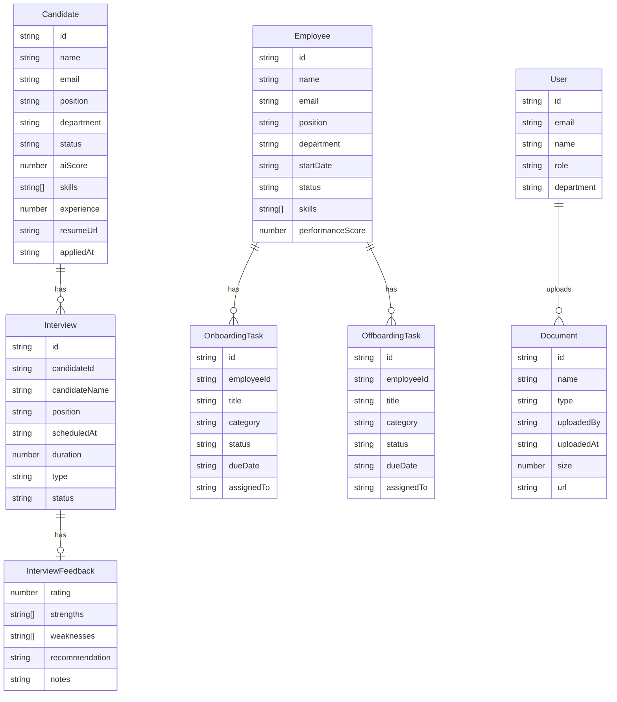

# What Data We Store

This document explains every piece of data TalentFlow tracks, how the pieces connect to each other, and the full list of API endpoints (the URLs the app uses to read and write that data).

---

## How the Data Connects

The diagram below shows the relationships between the main data types. An arrow means "belongs to" or "references".

---

## Field-by-Field Breakdown

### User — login accounts

| Field | What it means |
|---|---|
| `id` | Unique ID, generated automatically |
| `email` | Used to log in |
| `password` | Stored as a secure hash — never the real password |
| `name` | Display name shown in the app |
| `role` | `hr`, `manager`, or `employee` — controls what they can see |
| `department` | Optional — the team they belong to |

### Candidate — job applicants

| Field | What it means |
|---|---|
| `id` | Unique ID |
| `name`, `email`, `phone` | Contact info |
| `position` | The role they applied for |
| `department` | Which team they're applying to join |
| `status` | Where they are in the pipeline: `new → screening → interview → offer → hired / rejected` |
| `aiScore` | A 0–100 fit score (optional, can be set manually) |
| `skills` | List of skills they have |
| `experience` | Years of experience |
| `resumeUrl` | Link to their uploaded resume |
| `appliedAt` | When they were added |
| `notes` | HR notes — internal only |

### Interview

| Field | What it means |
|---|---|
| `candidateId` | Which candidate this interview is for |
| `candidateName`, `position` | Copied from the candidate so the interview makes sense on its own |
| `scheduledAt` | Date and time of the interview |
| `duration` | How long it's planned to last (in minutes) |
| `type` | `phone`, `video`, `onsite`, or `ai` |
| `status` | `scheduled`, `completed`, or `cancelled` |
| `interviewers` | List of people conducting the interview |
| `feedback` | Added after the interview (see below) |

### Interview Feedback

| Field | What it means |
|---|---|
| `rating` | Overall score 1–5 |
| `strengths` | What went well |
| `weaknesses` | Areas of concern |
| `recommendation` | `strong_hire`, `hire`, `not_sure`, `no_hire`, or `strong_no_hire` |
| `notes` | Free-form comments |

### Employee

| Field | What it means |
|---|---|
| `name`, `email`, `phone` | Contact info |
| `position` | Job title |
| `department` | Team |
| `manager` | Their manager's name |
| `startDate` | When they started (or will start) |
| `status` | `onboarding`, `active`, `offboarding`, or `inactive` |
| `skills` | Skill tags |
| `performanceScore` | Last review score, 0–5 |

### Onboarding / Offboarding Task

Both types share the same structure:

| Field | What it means |
|---|---|
| `employeeId` | Which employee this task belongs to |
| `title` | What needs to be done |
| `description` | Details |
| `category` | Onboarding: `documentation`, `training`, `equipment`, `introduction`, `compliance`. Offboarding: `exit_interview`, `asset_return`, `knowledge_transfer`, `access_revoke`, `final_pay` |
| `status` | `pending`, `in_progress`, or `completed` |
| `dueDate` | When it needs to be done by |
| `assignedTo` | Who is responsible |

### Document

| Field | What it means |
|---|---|
| `name` | Display name in the app |
| `type` | `resume`, `contract`, `policy`, `certificate`, or `other` |
| `uploadedBy` | The user ID of whoever uploaded it |
| `uploadedAt` | Timestamp |
| `size` | File size in bytes |
| `url` | The path to download it (`/uploads/filename.pdf`) |
| `employeeId` | Optional — links the document to a specific employee |

---

## API Endpoints

Every endpoint requires a login token in the request header (`Authorization: Bearer <token>`), except for login and signup.

### Authentication

| Method | URL | What it does |
|---|---|---|
| POST | `/api/auth/login` | Log in. Returns a token and your user info. |
| POST | `/api/auth/register` | Create a new account. |

### Candidates

| Method | URL | What it does |
|---|---|---|
| GET | `/api/candidates` | Get all candidates |
| POST | `/api/candidates` | Add a new candidate |
| PUT | `/api/candidates/:id` | Update a candidate (including changing their status) |
| DELETE | `/api/candidates/:id` | Remove a candidate |

### Interviews

| Method | URL | What it does |
|---|---|---|
| GET | `/api/interviews` | Get all interviews |
| POST | `/api/interviews` | Schedule an interview |
| PUT | `/api/interviews/:id` | Update an interview |
| DELETE | `/api/interviews/:id` | Cancel an interview |
| POST | `/api/interviews/:id/feedback` | Submit feedback after the interview |

### Employees

| Method | URL | What it does |
|---|---|---|
| GET | `/api/employees` | Get all employees |
| POST | `/api/employees` | Add a new employee |
| PUT | `/api/employees/:id` | Update an employee record |
| DELETE | `/api/employees/:id` | Remove an employee |

### Onboarding & Offboarding

| Method | URL | What it does |
|---|---|---|
| GET | `/api/onboarding` | List all onboarding tasks |
| POST | `/api/onboarding` | Create a task |
| PUT | `/api/onboarding/:id` | Update a task (e.g., mark complete) |
| GET | `/api/offboarding` | List all offboarding tasks |
| POST | `/api/offboarding` | Create a task |
| PUT | `/api/offboarding/:id` | Update a task |

### Documents

| Method | URL | What it does |
|---|---|---|
| GET | `/api/documents` | List all documents |
| POST | `/api/documents/upload` | Upload a file (PDF, DOC, DOCX, or TXT — max 10 MB) |
| DELETE | `/api/documents/:id` | Delete a document record |

### Analytics

| Method | URL | What it does |
|---|---|---|
| GET | `/api/analytics` | Get live HR metrics: headcount, new hires, time-to-hire, turnover rate, hiring trend, department breakdown |

### Your Profile

| Method | URL | What it does |
|---|---|---|
| GET | `/api/users/me` | Get your own profile |
| PUT | `/api/users/me` | Update your name or email |
