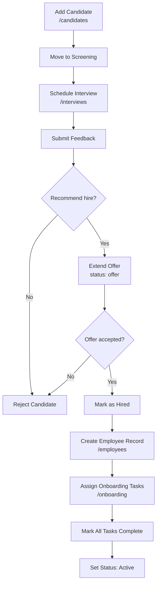
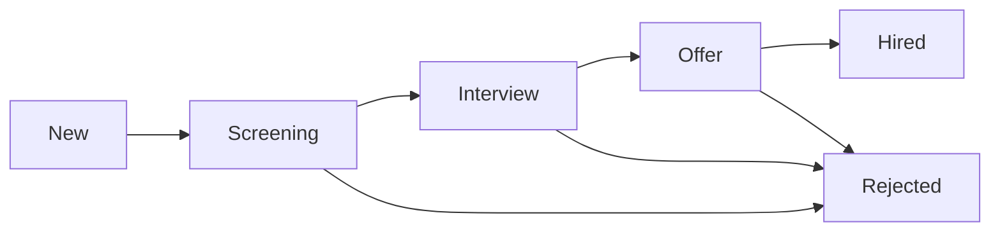
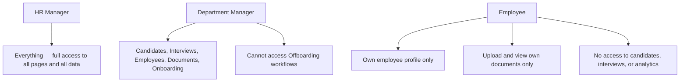

# How to Use TalentFlow

This guide walks through the most common things you'll do in TalentFlow — from logging in to completing a full hire.

---

## Logging In

Go to the app URL and enter your email and password. If your credentials are correct, you'll land on the Dashboard. Your session stays active for 7 days before you need to log in again.

There are two demo accounts available on a fresh install:

| Email | Password | Role |
|---|---|---|
| `admin@example.com` | `demo123` | HR Manager |
| `manager@example.com` | `demo123` | Department Manager |

---

## The Hiring Journey — From Candidate to Employee

Here's the full path from finding someone to hiring them. Each step is a page in TalentFlow.

### Step 1 — Add a Candidate

Go to **Candidates** and click **Add Candidate**. Fill in their name, email, role they're applying for, department, skills, and years of experience. They start with a status of **New**.

### Step 2 — Screen Them

Review their application. When you're ready to move forward, edit the candidate and change their status to **Screening**.

### Step 3 — Schedule an Interview

Go to **Interviews** and click **Schedule Interview**. Pick the candidate, set the date and time, choose the interview type (phone, video, on-site, or AI), and add the interviewers.

### Step 4 — Record Feedback

After the interview, find it in the Interviews list and click **Add Feedback**. Rate the candidate 1–5, note their strengths and weaknesses, and pick a recommendation.

### Step 5 — Extend an Offer

If the interview went well, go back to the candidate and change their status to **Offer**.

### Step 6 — Hire Them

When they accept, change their status to **Hired**.

### Step 7 — Create an Employee Record

Go to **Employees** and click **Add Employee**. Fill in their details. Their status will be **Onboarding** to start.

### Step 8 — Assign and Complete Onboarding Tasks

Go to **Onboarding** and create tasks for the new employee: signing contracts, setting up equipment, completing compliance training, meeting the team, etc. As each task is finished, mark it **Completed**. When everything's done, update the employee's status to **Active**.

---

## The Candidate Pipeline at a Glance

A candidate can be rejected at any stage. You can also move them back to an earlier stage if circumstances change.

---

## What Each Role Can Do

Your role determines which pages you can see and which actions you can take. HR Managers have the most access; Employees the least.

HR Managers can temporarily switch to view the app as a Department Manager or Employee to see what they'd see. This is useful for demos and checking permissions. Only HR Managers can do this.

---

## Onboarding Workflow

When a new employee is added, you create a checklist of tasks for them to complete before they're considered fully onboarded.

Task categories:

| Category | Examples |
|---|---|
| `documentation` | Sign employment contract, complete W-4 |
| `compliance` | Watch mandatory training, sign data policy |
| `equipment` | Set up laptop, get access badge |
| `training` | Product training, tools walkthrough |
| `introduction` | Meet the team, 1-on-1 with manager |

Each task can be assigned to a specific person with a due date. Tasks move from **Pending** → **In Progress** → **Completed**.

---

## Offboarding Workflow

When someone is leaving, change their status to **Offboarding** and create a checklist of exit tasks.

Task categories:

| Category | Examples |
|---|---|
| `exit_interview` | Schedule and conduct exit conversation |
| `asset_return` | Collect laptop, keys, badge |
| `knowledge_transfer` | Handover documentation |
| `access_revoke` | Remove system access, deactivate accounts |
| `final_pay` | Process final paycheck |

When all tasks are complete, set the employee's status to **Inactive**. They'll be removed from the active headcount in analytics.

---

## Managing Documents

Go to **Documents** to upload HR files. Supported file types: PDF, DOC, DOCX, and TXT. Maximum size: 10 MB.

Each document has a type: `resume`, `contract`, `policy`, `certificate`, or `other`. You can optionally link it to a specific employee.

**Who can see what:**

- HR Managers and Department Managers see all documents
- Employees see only documents they uploaded themselves (or ones linked to their employee record)

To download a document, click its name. To delete one, click the delete icon (HR and Managers only).

---

## Updating Your Profile

Go to **Settings** to update your display name or email address. Your role cannot be changed from Settings — only an HR Manager can reassign roles.
